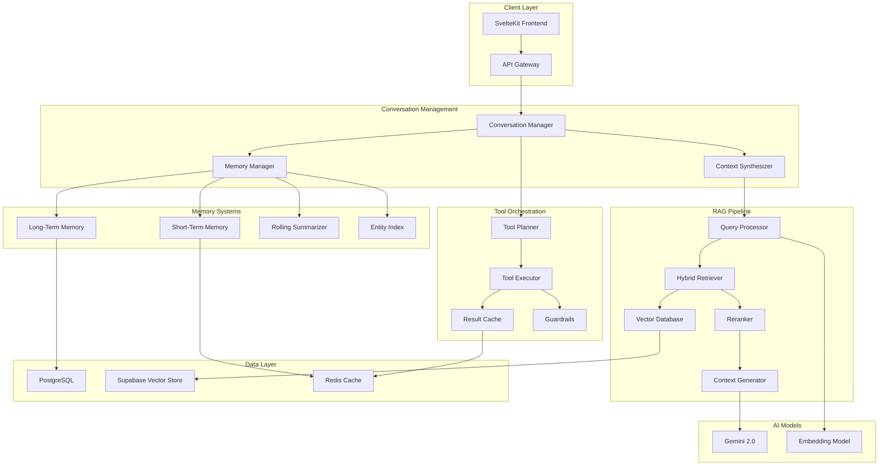

# 🏗️ Context-Aware AI System - Complete Architectural Redesign

## 📋 Executive Summary

This document outlines a complete architectural redesign of the MAP-IT SA-1 AI system to transform it from a basic Q&A system into a sophisticated, context-aware conversational AI with advanced memory management, RAG capabilities, and tool orchestration as recommended by industry best practices.

## 🔍 Current System Analysis

### Existing Components
1. **Basic RAG Service** (`app/services/rag_service.py`)
   - Simple CORDIS API integration
   - Basic Gemini/OpenAI integration
   - Limited context awareness
   - No proper memory management

2. **Conversation Context Service** (`app/services/conversation_context_service.py`)
   - Basic message history retrieval
   - Simple pattern matching for references
   - No summarization or compression
   - Limited to 20 messages

3. **Vector Search** (`app/services/vector_search_service.py`)
   - Basic semantic search
   - Simple embedding service
   - No hybrid search optimization
   - No intelligent chunking strategy

### Critical Gaps Identified

#### ❌ Memory Management
- No short-term/long-term memory separation
- No rolling summarization
- No fact extraction or entity tracking
- Inefficient token usage (raw message stacking)

#### ❌ RAG System
- No conversation-aware retrieval
- Missing hybrid search (vector + keyword)
- No chunk reranking
- No grounded prompt blocks
- No citation tracking

#### ❌ Context Management
- No progressive summarization
- No selective recall
- No context window optimization
- Missing entity cards and constraint tracking

#### ❌ Tool/Agent Orchestration
- No tool planning system
- No result caching
- No parallel execution
- Missing guardrails and schemas

## 🎯 Target Architecture

### Core Principles
1. **Hybrid Memory Strategy**: Combine recent verbatim turns with rolling summaries
2. **Retrieval-Augmented Generation**: Ground responses in retrieved documents
3. **Tool Orchestration**: Intelligent tool selection and result caching
4. **Stream-First Design**: Progressive response generation
5. **Observability**: Comprehensive logging and monitoring

## 📐 System Architecture



## 🧠 Component Design

### 1. Memory Management System

#### Short-Term Memory (STM)
```python
class ShortTermMemory:
    """
    Maintains last N messages verbatim for local context
    - Capacity: 6-12 turns (configurable)
    - Storage: Redis for fast access
    - Format: Raw messages with metadata
    """
    max_turns: int = 12
    storage: Redis
    
    def add_turn(self, message: Message)
    def get_recent_turns(self, n: int) -> List[Message]
    def trim_to_capacity(self)
```

#### Long-Term Memory (LTM)
```python
class LongTermMemory:
    """
    Persistent storage of conversation summaries and facts
    - Rolling summaries updated after each turn
    - Extracted facts and decisions
    - Entity cards for important references
    """
    storage: PostgreSQL
    
    def store_summary(self, conversation_id: int, summary: Summary)
    def get_facts(self, conversation_id: int) -> List[Fact]
    def update_entity_card(self, entity: Entity)
```

#### Rolling Summarizer
```python
class RollingSummarizer:
    """
    Progressive summarization with drift prevention
    - Task-focused summaries (200-400 tokens)
    - Fact extraction and validation
    - Periodic full recomputation
    """
    def summarize_turn(self, context: Context, new_turn: Turn) -> Summary
    def extract_facts(self, summary: Summary) -> List[Fact]
    def recompute_from_scratch(self, full_history: List[Message])
```

### 2. RAG System Design

#### Conversation-Aware Retrieval
```python
class ConversationAwareRetriever:
    """
    Retrieval that understands conversation context
    - Query formulation using conversation goals
    - Cached chunk reuse within thread
    - Hybrid search with reranking
    """
    def formulate_query(self, user_turn: str, context: Context) -> Query
    def retrieve_chunks(self, query: Query) -> List[Chunk]
    def rerank_chunks(self, chunks: List[Chunk], context: Context) -> List[Chunk]
```

#### Hybrid Search Pipeline
```python
class HybridSearchPipeline:
    """
    Combines vector and keyword search
    - Vector similarity (top-20)
    - Keyword/metadata filters
    - Cross-encoder reranking (top-4)
    """
    def vector_search(self, embedding: np.array, limit: int) -> List[Result]
    def keyword_search(self, keywords: List[str], filters: Dict) -> List[Result]
    def merge_and_rerank(self, vector_results: List, keyword_results: List) -> List[Result]
```

#### Chunking Strategy
```python
class IntelligentChunker:
    """
    Semantic chunking with overlap
    - Chunk size: 200-800 tokens
    - Overlap: 10-20%
    - Metadata preservation
    """
    def chunk_document(self, document: Document) -> List[Chunk]
    def add_metadata(self, chunk: Chunk, document: Document) -> Chunk
    def validate_chunk_quality(self, chunk: Chunk) -> bool
```

### 3. Context Window Management

```python
class ContextWindowManager:
    """
    Optimizes context for LLM input
    - Recency window: Last 6-12 turns
    - Summary window: Rolling summary
    - Selective recall: Relevant facts/entities
    - Retrieved context: Top-K chunks
    """
    max_tokens: int = 8000
    
    def build_context(self, 
                      recent_turns: List[Turn],
                      summary: Summary,
                      facts: List[Fact],
                      retrieved_chunks: List[Chunk]) -> Context
    
    def optimize_for_tokens(self, context: Context) -> Context
```

### 4. Tool/Agent Orchestration

```python
class ToolOrchestrator:
    """
    Manages tool selection and execution
    - Tool planning based on intent
    - Parallel execution where possible
    - Result caching and validation
    - Error handling with retry
    """
    tools: Dict[str, Tool]
    planner: ToolPlanner
    executor: ToolExecutor
    cache: ResultCache
    
    def plan_tool_sequence(self, task: Task) -> List[ToolCall]
    def execute_tools(self, tool_calls: List[ToolCall]) -> List[Result]
    def validate_results(self, results: List[Result]) -> bool
```

## 💾 Database Schema Updates

### New Tables Required

```sql
-- Conversation Memory Table
CREATE TABLE conversation_memory (
    id SERIAL PRIMARY KEY,
    conversation_id INTEGER REFERENCES conversation(id),
    memory_type VARCHAR(50), -- 'summary', 'facts', 'entities'
    content JSONB,
    token_count INTEGER,
    created_at TIMESTAMP DEFAULT NOW(),
    updated_at TIMESTAMP DEFAULT NOW()
);

-- Fact Store Table
CREATE TABLE conversation_facts (
    id SERIAL PRIMARY KEY,
    conversation_id INTEGER REFERENCES conversation(id),
    fact_type VARCHAR(100),
    fact_content TEXT,
    confidence DECIMAL(3,2),
    source_message_id INTEGER REFERENCES message(id),
    extracted_at TIMESTAMP DEFAULT NOW()
);

-- Entity Cards Table
CREATE TABLE entity_cards (
    id SERIAL PRIMARY KEY,
    conversation_id INTEGER REFERENCES conversation(id),
    entity_type VARCHAR(50), -- 'project', 'organization', 'person', 'topic'
    entity_name VARCHAR(255),
    entity_data JSONB,
    first_mentioned_at TIMESTAMP,
    last_referenced_at TIMESTAMP,
    reference_count INTEGER DEFAULT 1
);

-- Retrieval Cache Table
CREATE TABLE retrieval_cache (
    id SERIAL PRIMARY KEY,
    conversation_id INTEGER REFERENCES conversation(id),
    query_hash VARCHAR(64),
    retrieved_chunks JSONB,
    relevance_scores JSONB,
    created_at TIMESTAMP DEFAULT NOW(),
    ttl_seconds INTEGER DEFAULT 3600
);

-- Tool Execution Log
CREATE TABLE tool_execution_log (
    id SERIAL PRIMARY KEY,
    conversation_id INTEGER REFERENCES conversation(id),
    message_id INTEGER REFERENCES message(id),
    tool_name VARCHAR(100),
    tool_input JSONB,
    tool_output JSONB,
    execution_time_ms INTEGER,
    success BOOLEAN,
    error_message TEXT,
    executed_at TIMESTAMP DEFAULT NOW()
);

-- Create indexes for performance
CREATE INDEX idx_conversation_memory_type ON conversation_memory(conversation_id, memory_type);
CREATE INDEX idx_facts_conversation ON conversation_facts(conversation_id);
CREATE INDEX idx_entity_cards_conversation ON entity_cards(conversation_id, entity_type);
CREATE INDEX idx_retrieval_cache_query ON retrieval_cache(conversation_id, query_hash);
CREATE INDEX idx_tool_log_conversation ON tool_execution_log(conversation_id);
```

## 🔄 Prompt Template Structure

### Optimal Context Assembly

```python
CONTEXT_TEMPLATE = """
# System Role and Objectives
{system_prompt}

# Conversation Summary
{rolling_summary}

# Key Facts and Constraints
{facts_and_constraints}

# Entity Information
{entity_cards}

# Recent Conversation (Last {n} turns)
{recent_messages}

# Retrieved Context
{retrieved_chunks}

# Current User Query
User: {current_query}

# Instructions
- Use ONLY the provided context for factual claims
- Cite sources when referencing retrieved information
- Maintain consistency with established facts
- If information is missing, explicitly state so
"""
```

## 📊 Performance Targets

### Latency Requirements
- **Context Resolution**: < 100ms
- **Memory Retrieval**: < 50ms
- **Vector Search**: < 200ms
- **Reranking**: < 100ms
- **First Token (Streaming)**: < 500ms
- **Complete Response**: < 3s

### Resource Optimization
- **Context Window**: Max 8K tokens
- **Summary Size**: 200-400 tokens
- **Facts List**: Max 20 items
- **Retrieved Chunks**: 3-6 chunks
- **Cache TTL**: 1 hour for retrieval, 30 min for summaries

## 🚀 Implementation Phases

### Phase 1: Foundation (Week 1-2)
- [ ] Set up database schema updates
- [ ] Implement basic memory management
- [ ] Create context window manager
- [ ] Set up Redis for caching

### Phase 2: Memory Systems (Week 2-3)
- [ ] Implement short-term memory
- [ ] Build rolling summarizer
- [ ] Create fact extraction system
- [ ] Develop entity card management

### Phase 3: RAG Enhancement (Week 3-4)
- [ ] Upgrade chunking strategy
- [ ] Implement hybrid search
- [ ] Add reranking system
- [ ] Build retrieval cache

### Phase 4: Tool Orchestration (Week 4-5)
- [ ] Create tool planner
- [ ] Implement tool executor
- [ ] Add result caching
- [ ] Build guardrails system

### Phase 5: Integration (Week 5-6)
- [ ] Integrate all components
- [ ] Update API endpoints
- [ ] Implement streaming
- [ ] Add monitoring

### Phase 6: Testing & Optimization (Week 6-7)
- [ ] Performance testing
- [ ] Load testing
- [ ] Prompt optimization
- [ ] Documentation

## 🔌 API Contract Updates

### Enhanced Conversation Endpoint
```typescript
POST /api/conversation/{id}/message
{
  message: string;
  include_context: boolean;
  memory_strategy: 'full' | 'summary' | 'minimal';
  retrieval_config?: {
    max_chunks: number;
    similarity_threshold: number;
    use_cache: boolean;
  };
  tools_enabled?: string[];
}

Response:
{
  response: string;
  memory_used: {
    short_term_turns: number;
    summary_tokens: number;
    facts_count: number;
    entities_referenced: string[];
  };
  retrieval_stats: {
    chunks_retrieved: number;
    sources_cited: string[];
    cache_hit: boolean;
  };
  tools_executed: {
    tool_name: string;
    execution_time_ms: number;
    cached: boolean;
  }[];
  processing_time_ms: number;
}
```

## 📈 Monitoring & Observability

### Key Metrics
- **Memory efficiency**: Token usage vs information retention
- **Retrieval precision**: Relevance scores and citation accuracy
- **Summarization quality**: Drift detection and fact preservation
- **Tool execution**: Success rates and latency
- **Cache hit rates**: Memory, retrieval, and tool caches

### Logging Strategy
```python
{
  "event": "conversation_turn",
  "conversation_id": 123,
  "metrics": {
    "memory": {
      "stm_size": 8,
      "summary_tokens": 350,
      "facts_extracted": 5
    },
    "retrieval": {
      "chunks_retrieved": 4,
      "avg_relevance": 0.85,
      "cache_hit": true
    },
    "performance": {
      "total_ms": 1250,
      "memory_ms": 45,
      "retrieval_ms": 180,
      "generation_ms": 980
    }
  }
}
```

## 🔐 Security & Privacy

### Data Protection
- Conversation memory encryption at rest
- PII detection and masking in summaries
- Secure credential management for tools
- Rate limiting per conversation

### Access Control
- User-scoped conversation access
- Admin-only memory management
- Audit logging for sensitive operations

## 🎯 Success Criteria

### Functional Requirements
- ✅ Maintains context across 50+ turn conversations
- ✅ Retrieves and cites relevant information accurately
- ✅ Handles tool execution with < 5% failure rate
- ✅ Provides streaming responses with < 500ms TTFT

### Performance Requirements
- ✅ 90% of responses under 3 seconds
- ✅ Memory usage < 500MB per conversation
- ✅ Cache hit rate > 60% for common queries
- ✅ Token efficiency improved by 40%

### Quality Requirements
- ✅ Hallucination rate < 5%
- ✅ Citation accuracy > 95%
- ✅ Context relevance score > 0.8
- ✅ User satisfaction > 4.5/5

## 📚 References

Based on industry best practices and the Perplexity recommendations:
- Hybrid memory strategies for LLM conversations
- RAG best practices for grounding and citation
- Context window optimization techniques
- Tool orchestration patterns for AI agents

---

**This architectural redesign will transform your AI system into a production-ready, context-aware conversational platform that matches or exceeds industry standards for research management AI tools.**