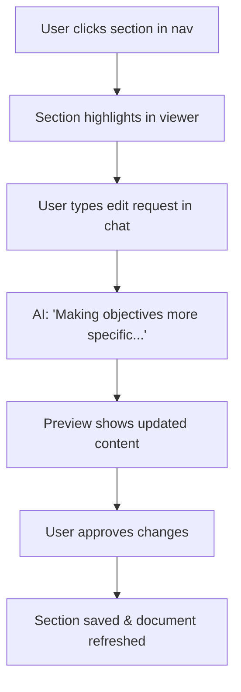

# Live Proposal Editor - Frontend Integration Guide

## 🎯 Overview

This guide provides complete instructions for integrating the **Live Proposal Document Editor** into your frontend application. This feature enables research managers to write proposals collaboratively with AI assistance, seeing real-time updates in a split-view interface.

## 📋 Table of Contents

1. [Architecture Overview](#architecture-overview)
2. [API Endpoints](#api-endpoints)
3. [Frontend Components](#frontend-components)
4. [User Flows](#user-flows)
5. [Implementation Guide](#implementation-guide)
6. [Best Practices](#best-practices)
7. [Troubleshooting](#troubleshooting)

---

## 🏗️ Architecture Overview

### Split-View Layout

```
┌─────────────────────────────────────────────────────────────┐
│                     Header / Navigation                      │
├──────────────────────────┬──────────────────────────────────┤
│                          │                                   │
│   Chat Interface         │   Proposal Document Viewer       │
│   (40% width)            │   (60% width)                    │
│                          │                                   │
│  ┌────────────────────┐  │  ┌────────────────────────────┐  │
│  │ AI: How can I help?│  │  │ 📄 My Proposal - HORIZON..│  │
│  ├────────────────────┤  │  ├────────────────────────────┤  │
│  │ User: Write obj... │  │  │ Progress: 35% (3/8)       │  │
│  ├────────────────────┤  │  ├────────────────────────────┤  │
│  │ AI: Generating...  │  │  │ 1. Excellence ✓           │  │
│  │ [Progress bar]     │  │  │    • Objectives    [850w] │  │
│  └────────────────────┘  │  │    • Methodology   [0w]   │  │
│                          │  │ 2. Impact ⏳               │  │
│  ┌────────────────────┐  │  │    • Impact        [420w] │  │
│  │ Type message...    │  │  │                            │  │
│  └────────────────────┘  │  │ ┌────────────────────────┐│  │
│                          │  │ │  EXCELLENCE             ││  │
│                          │  │ │  Objectives             ││  │
│                          │  │ │  ─────────────          ││  │
│                          │  │ │  Our project aims to... ││  │
│                          │  │ │  ...                    ││  │
│                          │  │ └────────────────────────┘│  │
└──────────────────────────┴──────────────────────────────────┘
```

### Data Flow

```
┌──────────┐         ┌──────────┐         ┌──────────┐
│ Frontend │◄───────►│  API     │◄───────►│ Database │
│          │         │          │         │          │
└──────────┘         └──────────┘         └──────────┘
     │                     │                     │
     │  1. User message    │                     │
     │────────────────────►│                     │
     │                     │  2. AI processing   │
     │                     │────────────────────►│
     │  3. Stream updates  │                     │
     │◄────────────────────│                     │
     │  4. Fetch document  │                     │
     │────────────────────►│  5. Get sections    │
     │                     │────────────────────►│
     │  6. Document data   │                     │
     │◄────────────────────│◄────────────────────│
```

---

## 🔌 API Endpoints

### Base URL
```
http://localhost:8000/api
```

### 1. Get Complete Proposal Document

**Endpoint**: `GET /proposal-document/{proposal_id}`

**Purpose**: Load entire proposal with all sections for document viewer

**Response**:
```json
{
  "proposal_id": 123,
  "call_id": "HORIZON-CL3-2025-02-CS-ECCC-01",
  "proposal_title": "AI-Powered Cybersecurity Platform",
  "proposal_acronym": "AICP",
  "proposal_type": "RIA",
  "status": "draft",
  "created_at": "2025-10-11T10:00:00",
  "updated_at": "2025-10-11T14:30:00",
  "sections": [
    {
      "section_id": "excellence.objectives",
      "section_name": "Objectives",
      "content": "## Project Objectives\n\nOur project aims to...",
      "word_count": 850,
      "estimated_pages": 1.7,
      "last_updated": "2025-10-11T14:30:00",
      "quality_score": 0.85
    },
    {
      "section_id": "excellence.methodology",
      "section_name": "Methodology",
      "content": "",
      "word_count": 0,
      "estimated_pages": 0,
      "last_updated": "2025-10-11T10:00:00",
      "quality_score": null
    }
  ],
  "progress": {
    "total_sections": 8,
    "completed_sections": 3,
    "completion_percentage": 37.5,
    "total_words": 2450,
    "estimated_pages": 4.9
  }
}
```

**Frontend Usage**:
```typescript
async function loadProposal(proposalId: number) {
  const response = await fetch(`/api/proposal-document/${proposalId}`);
  const proposal = await response.json();
  
  // Update UI
  setProposalData(proposal);
  setSections(proposal.sections);
  setProgress(proposal.progress);
}
```

---

### 2. Get Single Section

**Endpoint**: `GET /proposal-document/{proposal_id}/section/{section_id}`

**Purpose**: Load specific section for focused editing

**Example**: `GET /proposal-document/123/section/excellence.objectives`

**Response**:
```json
{
  "section_id": "excellence.objectives",
  "section_name": "Objectives",
  "content": "## Project Objectives\n\nOur project aims to...",
  "word_count": 850,
  "estimated_pages": 1.7,
  "last_updated": "2025-10-11T14:30:00",
  "quality_score": 0.85
}
```

---

### 3. Update Section Content

**Endpoint**: `PUT /proposal-document/{proposal_id}/section/{section_id}`

**Purpose**: Save manual edits or AI-generated content

**Request Body**:
```json
{
  "content": "## Updated Objectives\n\nRevised content...",
  "metadata": {
    "quality_score": 0.9
  }
}
```

**Response**:
```json
{
  "success": true,
  "message": "Section updated successfully",
  "word_count": 920,
  "estimated_pages": 1.8
}
```

**Frontend Usage**:
```typescript
async function saveSection(proposalId: number, sectionId: string, content: string) {
  const response = await fetch(
    `/api/proposal-document/${proposalId}/section/${sectionId}`,
    {
      method: 'PUT',
      headers: { 'Content-Type': 'application/json' },
      body: JSON.stringify({ content })
    }
  );
  
  const result = await response.json();
  
  // Show success notification
  showToast(`Section saved! ${result.word_count} words`, 'success');
  
  // Refresh document
  await loadProposal(proposalId);
}
```

---

### 4. Get Progress Information

**Endpoint**: `GET /proposal-document/{proposal_id}/progress`

**Purpose**: Display progress indicators and completion status

**Response**:
```json
{
  "proposal_id": 123,
  "overall_progress": {
    "completion_percentage": 37.5,
    "total_sections": 8,
    "complete_sections": 3,
    "draft_sections": 2,
    "empty_sections": 3,
    "total_words": 2450,
    "estimated_pages": 4.9,
    "average_quality": 0.83
  },
  "sections": [
    {
      "section_id": "excellence.objectives",
      "section_name": "Objectives",
      "word_count": 850,
      "status": "complete",
      "quality_score": 0.85,
      "estimated_pages": 1.7
    },
    {
      "section_id": "excellence.methodology",
      "section_name": "Methodology",
      "word_count": 45,
      "status": "draft",
      "quality_score": 0.6,
      "estimated_pages": 0.1
    },
    {
      "section_id": "impact.dissemination",
      "section_name": "Dissemination",
      "word_count": 0,
      "status": "empty",
      "quality_score": null,
      "estimated_pages": 0
    }
  ]
}
```

---

### 5. Conversational Editing (via Streaming Endpoint)

**Endpoint**: `POST /v2/conversation/{conversation_id}/message/stream`

**Purpose**: AI-powered proposal editing through natural language

**Request Body**:
```json
{
  "message": "Make the objectives more specific and add measurable KPIs",
  "userId": "research-manager-123"
}
```

**Response**: Server-Sent Events (SSE) stream

```javascript
// Event stream examples:
data: {"type": "status", "stage": "analyzing", "message": "Understanding your request..."}
data: {"type": "progress", "stage": "intent_detected", "routing_decision": "proposal_writing"}
data: {"type": "status", "stage": "proposal_preparation", "message": "Preparing to edit section..."}
data: {"type": "token", "content": "## Revised Objectives\n\n"}
data: {"type": "token", "content": "Our project aims to develop..."}
data: {"type": "complete", "proposal_draft": {...}}
```

**Frontend Usage**:
```typescript
async function sendEditRequest(message: string) {
  const eventSource = new EventSource(
    `/api/v2/conversation/${conversationId}/message/stream`,
    {
      method: 'POST',
      body: JSON.stringify({ message, userId: currentUser.id })
    }
  );
  
  eventSource.onmessage = (event) => {
    const data = JSON.parse(event.data);
    
    switch (data.type) {
      case 'status':
        setStatus(data.message);
        break;
      case 'token':
        appendToPreview(data.content);
        break;
      case 'complete':
        // Save updated section
        saveSection(proposalId, currentSection, previewContent);
        break;
    }
  };
}
```

---

## 🎨 Frontend Components

### 1. ProposalEditorLayout

**Purpose**: Main container with split view

**Props**:
```typescript
interface ProposalEditorLayoutProps {
  proposalId: number;
  conversationId: number;
  userId: string;
}
```

**Features**:
- Responsive split-view layout (adjustable)
- Chat interface on left (40%)
- Document viewer on right (60%)
- Mobile: Tabbed interface (chat/document toggle)

---

### 2. ProposalDocumentViewer

**Purpose**: Display proposal document with navigation

**Props**:
```typescript
interface ProposalDocumentViewerProps {
  proposalId: number;
  sections: ProposalSection[];
  progress: Progress;
  currentSection?: string;
  onSectionClick: (sectionId: string) => void;
}
```

**Features**:
- **Navigation Sidebar**: Table of contents with completion indicators
- **Section Viewer**: Rendered markdown with syntax highlighting
- **Progress Bar**: Visual completion tracking
- **Word Count**: Real-time word/page estimates
- **Quality Indicators**: Traffic light system (🟢🟡🔴)

**Example Component (React)**:
```typescript
function ProposalDocumentViewer({ proposalId, sections, progress }: Props) {
  const [activeSection, setActiveSection] = useState('excellence.objectives');
  
  return (
    <div className="proposal-viewer">
      {/* Header with title and progress */}
      <div className="proposal-header">
        <h2>{proposal.title}</h2>
        <ProgressBar 
          percentage={progress.completion_percentage}
          label={`${progress.completed_sections}/${progress.total_sections} sections`}
        />
      </div>
      
      {/* Navigation Sidebar */}
      <div className="proposal-nav">
        {sections.map(section => (
          <SectionNavItem
            key={section.section_id}
            section={section}
            active={activeSection === section.section_id}
            onClick={() => setActiveSection(section.section_id)}
          />
        ))}
      </div>
      
      {/* Section Content */}
      <div className="proposal-content">
        <SectionHeader section={currentSection} />
        <MarkdownRenderer content={currentSection.content} />
        <SectionFooter 
          wordCount={currentSection.word_count}
          pages={currentSection.estimated_pages}
        />
      </div>
    </div>
  );
}
```

---

### 3. SectionNavItem

**Purpose**: Navigation item with status indicators

**Visual Design**:
```
┌─────────────────────────────────────┐
│ 1. Excellence ✓ (75%)               │
│   ├─ ✓ Objectives         [850w]   │
│   ├─ ⏳ Methodology         [45w]   │
│   └─ ⭕ State of Art        [0w]    │
│                                      │
│ 2. Impact ⏳ (40%)                  │
│   ├─ ✓ Impact Strategy     [650w]   │
│   └─ ⭕ Dissemination        [0w]   │
│                                      │
│ 3. Implementation ⭕ (0%)           │
│   ├─ ⭕ Work Plan            [0w]   │
│   └─ ⭕ Consortium           [0w]   │
└─────────────────────────────────────┘

Legend:
✓  = Complete (>100 words)
⏳ = Draft (1-100 words)
⭕ = Empty (0 words)
[Nw] = Word count
```

**Component**:
```typescript
function SectionNavItem({ section, active, onClick }: Props) {
  const statusIcon = getStatusIcon(section.word_count);
  const statusColor = getStatusColor(section.word_count);
  
  return (
    <div 
      className={`nav-item ${active ? 'active' : ''}`}
      onClick={onClick}
    >
      <span className={`status-icon ${statusColor}`}>{statusIcon}</span>
      <span className="section-name">{section.section_name}</span>
      <span className="word-count">[{section.word_count}w]</span>
    </div>
  );
}

function getStatusIcon(wordCount: number): string {
  if (wordCount > 100) return '✓';
  if (wordCount > 0) return '⏳';
  return '⭕';
}
```

---

### 4. ChatInterface

**Purpose**: AI chat for editing requests

**Features**:
- Message history
- Streaming responses
- Quick actions (e.g., "Draft next section", "Improve current")
- Progress indicators during AI generation

**Example Quick Actions**:
```typescript
const quickActions = [
  { label: "Draft next section", icon: "✍️", action: "draft_next" },
  { label: "Improve current", icon: "✨", action: "improve" },
  { label: "Make more specific", icon: "🎯", action: "be_specific" },
  { label: "Add examples", icon: "💡", action: "add_examples" },
  { label: "Check compliance", icon: "✓", action: "compliance" }
];
```

---

## 👥 User Flows

### Flow 1: Initial Proposal Creation

```mermaid
graph TD
    A[User clicks "New Proposal"] --> B[Select Call ID]
    B --> C[Enter Project Details]
    C --> D[AI Generates Template]
    D --> E[Document Viewer Opens]
    E --> F[Chat: "Write objectives"]
    F --> G[AI Streams Content]
    G --> H[Section Updates in Real-Time]
    H --> I[User Reviews & Edits]
```

**Implementation Steps**:

1. **User initiates new proposal**:
```typescript
// 1. Create proposal record
const response = await fetch('/api/proposal/generate-template', {
  method: 'POST',
  body: JSON.stringify({
    call_id: 'HORIZON-CL3-2025-02-CS-ECCC-01',
    user_id: currentUser.id
  })
});

const { proposal_id } = await response.json();

// 2. Navigate to editor
router.push(`/proposal/${proposal_id}/edit`);
```

2. **Load proposal editor**:
```typescript
// 3. Load initial state
const proposal = await loadProposal(proposal_id);

// 4. Show welcome message in chat
showChatMessage({
  role: 'assistant',
  content: `Welcome! I've created a template for ${proposal.call_id}. 
           Let's start with the Excellence section. What would you like me to draft?`
});
```

3. **User requests first section**:
```typescript
// User types: "Write the objectives section for a cybersecurity AI project"
await sendMessage(conversationId, message);

// Document viewer shows loading state
setLoading(true, 'excellence.objectives');
```

4. **Stream response**:
```typescript
// Handle streaming updates
eventSource.onmessage = (event) => {
  const data = JSON.parse(event.data);
  
  if (data.type === 'token') {
    // Show live preview in document viewer
    updateSectionPreview('excellence.objectives', data.content);
  }
  
  if (data.type === 'complete') {
    // Save to database and refresh
    await saveSection(proposal_id, 'excellence.objectives', fullContent);
    await loadProposal(proposal_id);
    setLoading(false);
  }
};
```

---

### Flow 2: Editing Existing Section



**Implementation**:

```typescript
// User clicks "Objectives" in navigation
function handleSectionClick(sectionId: string) {
  setActiveSection(sectionId);
  scrollToSection(sectionId);
  
  // Add context message to chat
  addChatMessage({
    role: 'system',
    content: `Now viewing: ${getSectionName(sectionId)}`
  });
}

// User types: "Make this more specific and add measurable KPIs"
async function handleEditRequest(message: string) {
  // AI understands context from active section
  const fullMessage = `Edit section ${activeSection}: ${message}`;
  
  // Send to API
  await sendMessage(conversationId, fullMessage);
  
  // Show editing indicator
  setSectionStatus(activeSection, 'editing');
}
```

---

### Flow 3: Navigation Between Sections

```typescript
// User types: "Move to the next section" or "Continue to methodology"
// AI automatically:
// 1. Detects navigation intent
// 2. Determines next section (excellence.methodology)
// 3. Drafts content for that section
// 4. Updates document viewer to show new section

// Frontend receives:
{
  "type": "complete",
  "section_id": "excellence.methodology",
  "content": "...",
  "logs": {
    "mode": "proposal_writing",
    "action": "draft_section",
    "section_id": "excellence.methodology"
  }
}

// Frontend updates:
setActiveSection('excellence.methodology');
scrollToSection('excellence.methodology');
```

---

## 💻 Implementation Guide

### Step 1: Set Up State Management

**Using React Context** (recommended):

```typescript
// contexts/ProposalContext.tsx
interface ProposalContextValue {
  proposal: Proposal | null;
  sections: ProposalSection[];
  progress: Progress;
  activeSection: string;
  loading: boolean;
  
  loadProposal: (id: number) => Promise<void>;
  updateSection: (sectionId: string, content: string) => Promise<void>;
  setActiveSection: (sectionId: string) => void;
  refreshProgress: () => Promise<void>;
}

export const ProposalProvider = ({ children, proposalId }: Props) => {
  const [proposal, setProposal] = useState<Proposal | null>(null);
  const [sections, setSections] = useState<ProposalSection[]>([]);
  const [progress, setProgress] = useState<Progress | null>(null);
  const [activeSection, setActiveSection] = useState('excellence.objectives');
  const [loading, setLoading] = useState(false);
  
  const loadProposal = async (id: number) => {
    setLoading(true);
    try {
      const response = await fetch(`/api/proposal-document/${id}`);
      const data = await response.json();
      
      setProposal(data);
      setSections(data.sections);
      setProgress(data.progress);
    } catch (error) {
      console.error('Failed to load proposal:', error);
    } finally {
      setLoading(false);
    }
  };
  
  const updateSection = async (sectionId: string, content: string) => {
    try {
      await fetch(`/api/proposal-document/${proposalId}/section/${sectionId}`, {
        method: 'PUT',
        headers: { 'Content-Type': 'application/json' },
        body: JSON.stringify({ content })
      });
      
      // Refresh proposal
      await loadProposal(proposalId);
    } catch (error) {
      console.error('Failed to update section:', error);
    }
  };
  
  const refreshProgress = async () => {
    const response = await fetch(`/api/proposal-document/${proposalId}/progress`);
    const data = await response.json();
    setProgress(data.overall_progress);
  };
  
  return (
    <ProposalContext.Provider value={{
      proposal,
      sections,
      progress,
      activeSection,
      loading,
      loadProposal,
      updateSection,
      setActiveSection,
      refreshProgress
    }}>
      {children}
    </ProposalContext.Provider>
  );
};
```

---

### Step 2: Create Main Editor Page

```typescript
// pages/proposal/[id]/edit.tsx
export default function ProposalEditorPage() {
  const { id } = useParams();
  const proposalId = parseInt(id);
  const conversationId = proposalId; // Use same ID for conversation
  
  return (
    <ProposalProvider proposalId={proposalId}>
      <div className="editor-layout">
        <EditorHeader />
        
        <div className="editor-body">
          {/* Chat Interface - Left Side */}
          <div className="chat-panel">
            <ChatInterface 
              conversationId={conversationId}
              onMessage={handleMessage}
            />
          </div>
          
          {/* Document Viewer - Right Side */}
          <div className="document-panel">
            <ProposalDocumentViewer 
              proposalId={proposalId}
            />
          </div>
        </div>
      </div>
    </ProposalProvider>
  );
}
```

**CSS Layout**:
```css
.editor-layout {
  display: flex;
  flex-direction: column;
  height: 100vh;
}

.editor-body {
  display: grid;
  grid-template-columns: 40% 60%;
  gap: 1rem;
  flex: 1;
  overflow: hidden;
}

.chat-panel, .document-panel {
  display: flex;
  flex-direction: column;
  overflow-y: auto;
}

/* Mobile responsive */
@media (max-width: 768px) {
  .editor-body {
    grid-template-columns: 1fr;
  }
  
  .chat-panel {
    position: fixed;
    bottom: 0;
    left: 0;
    right: 0;
    height: 50vh;
    z-index: 1000;
  }
}
```

---

### Step 3: Implement Real-Time Updates

**Option A: Polling** (Simple, works everywhere)

```typescript
function useProposalPolling(proposalId: number, interval: number = 5000) {
  const { loadProposal } = useProposal();
  
  useEffect(() => {
    const timer = setInterval(() => {
      loadProposal(proposalId);
    }, interval);
    
    return () => clearInterval(timer);
  }, [proposalId, interval]);
}

// Usage in component:
useProposalPolling(proposalId);
```

**Option B: EventSource** (Better for real-time)

```typescript
function useProposalEvents(proposalId: number) {
  const { updateSection, refreshProgress } = useProposal();
  
  useEffect(() => {
    const eventSource = new EventSource(
      `/api/proposal-document/${proposalId}/events`
    );
    
    eventSource.addEventListener('section_updated', (event) => {
      const data = JSON.parse(event.data);
      updateSection(data.section_id, data.content);
    });
    
    eventSource.addEventListener('progress_updated', () => {
      refreshProgress();
    });
    
    return () => eventSource.close();
  }, [proposalId]);
}
```

---

### Step 4: Integrate with Chat

**Handle proposal editing messages**:

```typescript
function ChatInterface({ conversationId }: Props) {
  const { activeSection, updateSection } = useProposal();
  const [previewContent, setPreviewContent] = useState('');
  
  async function handleMessage(message: string) {
    // Clear preview
    setPreviewContent('');
    
    // Send message to API
    const response = await fetch(
      `/api/v2/conversation/${conversationId}/message/stream`,
      {
        method: 'POST',
        headers: { 'Content-Type': 'application/json' },
        body: JSON.stringify({ message, userId: currentUser.id })
      }
    );
    
    const reader = response.body.getReader();
    const decoder = new TextDecoder();
    
    while (true) {
      const { done, value } = await reader.read();
      if (done) break;
      
      const chunk = decoder.decode(value);
      const lines = chunk.split('\n');
      
      for (const line of lines) {
        if (line.startsWith('data: ')) {
          const data = JSON.parse(line.slice(6));
          
          if (data.type === 'token') {
            // Accumulate content for preview
            setPreviewContent(prev => prev + data.content);
          }
          
          if (data.type === 'complete') {
            // Extract section ID from logs
            const sectionId = data.logs?.section_id || activeSection;
            
            // Save to database
            await updateSection(sectionId, previewContent);
            
            // Show success message
            showToast('Section updated successfully!', 'success');
          }
        }
      }
    }
  }
  
  return (
    <div className="chat-interface">
      <MessageList messages={messages} />
      <MessageInput onSend={handleMessage} />
    </div>
  );
}
```

---

## 🎨 Best Practices

### 1. Performance Optimization

**Debounce Updates**:
```typescript
// Don't update on every keystroke - debounce
const debouncedSave = useMemo(
  () => debounce(updateSection, 1000),
  [updateSection]
);
```

**Lazy Load Sections**:
```typescript
// Only render visible section content
const visibleSection = sections.find(s => s.section_id === activeSection);

return (
  <div className="section-content">
    {visibleSection && (
      <MarkdownRenderer content={visibleSection.content} />
    )}
  </div>
);
```

**Virtual Scrolling** for long documents:
```typescript
import { FixedSizeList } from 'react-window';

<FixedSizeList
  height={800}
  itemCount={sections.length}
  itemSize={50}
>
  {({ index, style }) => (
    <SectionNavItem 
      style={style}
      section={sections[index]}
    />
  )}
</FixedSizeList>
```

---

### 2. User Experience

**Auto-save Indicator**:
```typescript
function AutoSaveIndicator({ saving, lastSaved }: Props) {
  if (saving) {
    return <span>💾 Saving...</span>;
  }
  
  return (
    <span className="text-muted">
      ✓ Saved {formatDistanceToNow(lastSaved)} ago
    </span>
  );
}
```

**Progress Celebrations**:
```typescript
function checkMilestones(progress: Progress) {
  const { completion_percentage } = progress;
  
  if (completion_percentage === 25) {
    showConfetti();
    showToast('🎉 Quarter done! Keep going!', 'success');
  }
  
  if (completion_percentage === 50) {
    showConfetti();
    showToast('🎉 Halfway there! Excellent progress!', 'success');
  }
  
  if (completion_percentage === 100) {
    showConfetti({ duration: 5000 });
    showToast('🎉 Proposal complete! Ready to export!', 'success');
  }
}
```

**Contextual Help**:
```typescript
// Show tips based on current section
const tips = {
  'excellence.objectives': 'Tip: Make objectives SMART (Specific, Measurable, Achievable, Relevant, Time-bound)',
  'excellence.methodology': 'Tip: Describe your approach step-by-step with clear milestones',
  'impact.dissemination': 'Tip: Identify specific target audiences and communication channels'
};

<TipBox content={tips[activeSection]} />
```

---

### 3. Error Handling

**Network Errors**:
```typescript
async function loadProposalWithRetry(id: number, maxRetries: number = 3) {
  for (let i = 0; i < maxRetries; i++) {
    try {
      return await loadProposal(id);
    } catch (error) {
      if (i === maxRetries - 1) throw error;
      
      // Wait before retry (exponential backoff)
      await new Promise(resolve => setTimeout(resolve, 1000 * (i + 1)));
    }
  }
}
```

**Validation**:
```typescript
function validateSection(section: ProposalSection): string[] {
  const errors: string[] = [];
  
  if (section.word_count < 100) {
    errors.push('Section too short (minimum 100 words)');
  }
  
  if (section.word_count > 2000) {
    errors.push('Section too long (maximum 2000 words)');
  }
  
  if (section.quality_score && section.quality_score < 0.6) {
    errors.push('Quality score below threshold - consider revision');
  }
  
  return errors;
}
```

---

### 4. Accessibility

**Keyboard Navigation**:
```typescript
function ProposalDocumentViewer() {
  useEffect(() => {
    const handleKeyPress = (e: KeyboardEvent) => {
      if (e.key === 'ArrowUp' && e.ctrlKey) {
        navigateToPreviousSection();
      }
      if (e.key === 'ArrowDown' && e.ctrlKey) {
        navigateToNextSection();
      }
    };
    
    window.addEventListener('keydown', handleKeyPress);
    return () => window.removeEventListener('keydown', handleKeyPress);
  }, []);
  
  return (/* ... */);
}
```

**Screen Reader Support**:
```typescript
<nav aria-label="Proposal sections">
  {sections.map(section => (
    <button
      key={section.section_id}
      aria-label={`${section.section_name}, ${section.word_count} words, ${section.status}`}
      aria-current={activeSection === section.section_id}
    >
      {section.section_name}
    </button>
  ))}
</nav>
```

---

## 🐛 Troubleshooting

### Issue: Document not loading

**Symptoms**: Blank document viewer, no sections shown

**Diagnosis**:
```typescript
// Check API response
const response = await fetch(`/api/proposal-document/${proposalId}`);
console.log('Status:', response.status);
console.log('Data:', await response.json());

// Check proposal ID
console.log('Proposal ID:', proposalId, typeof proposalId);

// Check database
// Run: SELECT * FROM proposals WHERE id = <proposalId>;
```

**Solutions**:
1. Ensure proposal exists in database
2. Check proposal ID is number, not string
3. Verify API endpoint is correct
4. Check CORS if frontend on different domain

---

### Issue: Sections not updating

**Symptoms**: AI generates content but document doesn't refresh

**Diagnosis**:
```typescript
// Add logging to update function
async function updateSection(sectionId: string, content: string) {
  console.log('Updating section:', sectionId);
  console.log('Content length:', content.length);
  
  const response = await fetch(/*...*/);
  console.log('Update response:', response.status);
  
  await loadProposal(proposalId);
  console.log('Proposal reloaded');
}
```

**Solutions**:
1. Check `proposal_id` matches in API calls
2. Ensure `section_id` format is correct (e.g., 'excellence.objectives')
3. Verify database update succeeded
4. Check if `loadProposal()` is called after update

---

### Issue: Chat disconnects

**Symptoms**: Stream stops mid-generation

**Solutions**:
1. Check server logs for errors
2. Increase timeout settings
3. Implement reconnection logic:

```typescript
function useReconnectingEventSource(url: string) {
  const [eventSource, setEventSource] = useState<EventSource | null>(null);
  
  useEffect(() => {
    let es: EventSource;
    let reconnectTimer: NodeJS.Timeout;
    
    function connect() {
      es = new EventSource(url);
      
      es.onerror = () => {
        es.close();
        // Reconnect after 3 seconds
        reconnectTimer = setTimeout(connect, 3000);
      };
      
      setEventSource(es);
    }
    
    connect();
    
    return () => {
      es?.close();
      clearTimeout(reconnectTimer);
    };
  }, [url]);
  
  return eventSource;
}
```

---

## 📚 Additional Resources

### Example Implementations

**Complete React Component**:
```typescript
// See: /examples/ProposalEditor.tsx
```

**Vue.js Implementation**:
```typescript
// See: /examples/ProposalEditor.vue
```

**Svelte Implementation**:
```typescript
// See: /examples/ProposalEditor.svelte
```

### API Testing

**Postman Collection**: Import `proposal-editor-api.postman_collection.json`

**cURL Examples**:
```bash
# Get proposal
curl http://localhost:8000/api/proposal-document/123

# Update section
curl -X PUT http://localhost:8000/api/proposal-document/123/section/excellence.objectives \
  -H "Content-Type: application/json" \
  -d '{"content": "Updated content..."}'

# Get progress
curl http://localhost:8000/api/proposal-document/123/progress
```

---

## 🎓 Summary

This guide provides everything needed to implement a professional, production-ready proposal editor with AI assistance. Key features:

✅ **Split-view interface** with chat and document viewer  
✅ **Real-time updates** as AI generates content  
✅ **Progress tracking** with visual indicators  
✅ **Natural language editing** through conversational AI  
✅ **Professional UX** suitable for research managers  
✅ **Complete API** for all operations  
✅ **Responsive design** for desktop and mobile  

For questions or support, please refer to the main project documentation or open an issue on GitHub.

---

**Last Updated**: October 11, 2025  
**Version**: 1.0.0  
**Maintainer**: Research Funding AI Team

