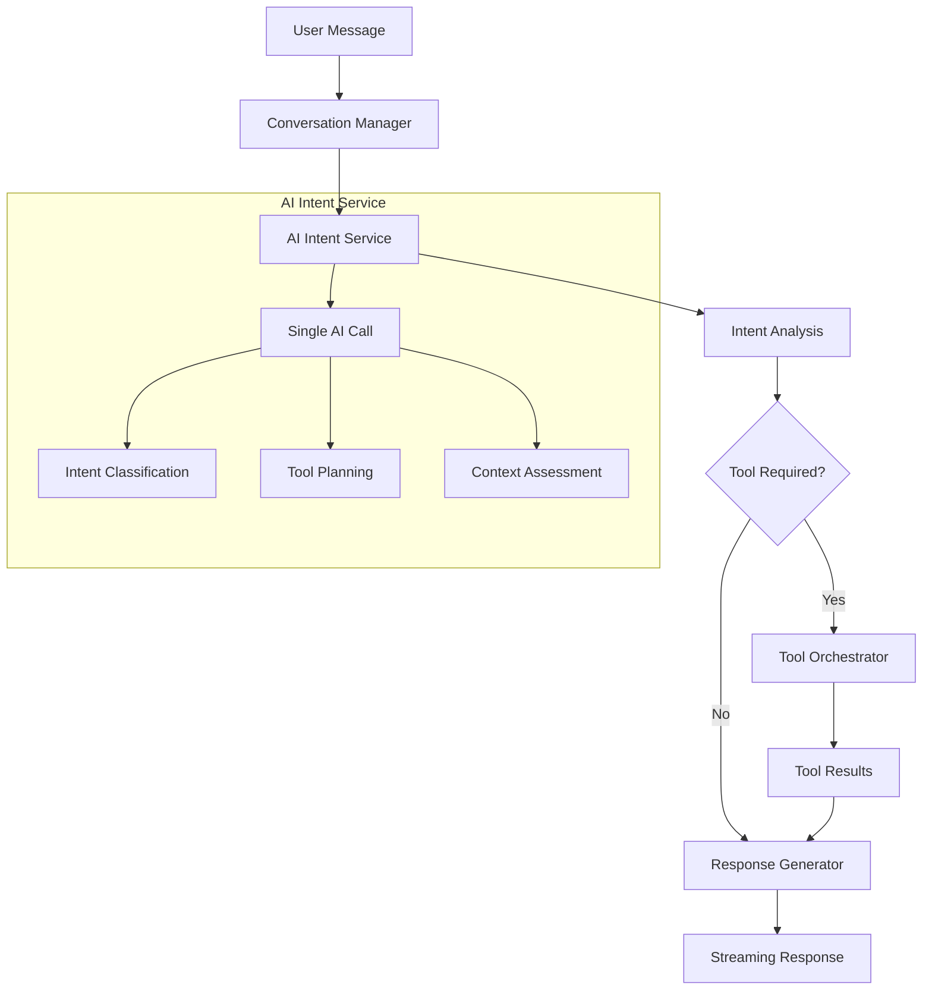

# Intent System Analysis and Improvement Plan

## Current System Analysis

### Problems with Current Rule-Based Intent System

#### 1. **Complex and Brittle Rule System**
The current system in `conversation_manager.py` has extensive keyword matching logic:
- **Lines 237-258**: 22+ project-related keywords
- **Lines 618-652**: 40+ call-related keywords
- **Lines 742-777**: Duplicate keyword lists
- **Lines 780-785**: Complex regex patterns for domain + funding combinations

#### 2. **Multiple Fallback Layers**
The system has multiple fallback mechanisms that create complexity:
- Primary AI intent analysis (`_analyze_intent`)
- Context-aware intent boosting (`_analyze_conversation_context_for_intent`)
- Enhanced forced tool planner (`_forced_tool_planner`)
- Combined intent-context-tool planner (`_combined_intent_context_tool_planner`)

#### 3. **Inconsistent AI Usage**
- AI is used but falls back to rules when it fails
- Mixed approach creates unpredictable behavior
- Complex prompt engineering with hardcoded rules

#### 4. **Maintenance Challenges**
- Hundreds of lines of keyword matching logic
- Difficult to add new intent types
- Hard to debug when rules conflict
- Context analysis adds another layer of complexity

## Current Streaming Endpoint Analysis

The V2 streaming endpoint (`send_message_stream`) in `conversation_routes_v2.py` (lines 79-123) processes messages through the conversation manager's 7-phase pipeline:

1. **Phase 1**: Store user message in memory
2. **Phase 2-4**: Combined intent analysis, context building, and tool planning (single AI call)
3. **Phase 5**: Retrieve information if needed
4. **Phase 6**: Execute tools if planned
5. **Phase 7**: Generate response

## Proposed AI-Only Intent System

### Architecture Design

#### 1. **Single AI Intent Service**
Create a new `AIIntentService` that handles all intent detection using only AI:

```python
class AIIntentService:
    async def analyze_intent(self, message: str, context: str) -> IntentAnalysis:
        # Single AI call with comprehensive prompt
        # Returns structured intent analysis
```

#### 2. **Simplified Conversation Manager**
Remove complex rule-based logic and rely entirely on AI:

```python
class ConversationManager:
    async def process_message(self, conversation_id: int, user_message: str, user_id: int, streaming: bool = False):
        # Phase 1: Store message
        # Phase 2: AI-only intent analysis
        # Phase 3: Tool execution based on AI decisions
        # Phase 4: Response generation
```

#### 3. **Structured Intent Analysis**
Replace keyword matching with structured AI analysis:

```python
@dataclass
class IntentAnalysis:
    intent_type: str  # "search_calls", "search_projects", "conversational", "clarification"
    confidence: float  # 0.0-1.0
    requires_tools: bool
    tool_plan: List[ToolCall]
    reasoning: str
    context_assessment: str
```

### Benefits of AI-Only Approach

1. **Consistency**: Single AI model makes all decisions
2. **Maintainability**: No complex rule systems to maintain
3. **Flexibility**: Easy to add new intent types
4. **Accuracy**: AI can understand context better than rules
5. **Reliability**: No rule conflicts or edge cases

### Implementation Plan

#### Phase 1: Create AI Intent Service
- Build `AIIntentService` with comprehensive prompt
- Handle all intent types: calls, projects, conversational, clarification
- Include context awareness in single AI call

#### Phase 2: Simplify Conversation Manager
- Remove rule-based intent detection methods
- Remove complex keyword matching logic
- Remove multiple fallback layers
- Use AI service for all intent decisions

#### Phase 3: Update Tool Planning
- Move tool planning into AI intent service
- Remove separate tool planner methods
- Let AI decide tool selection and parameters

#### Phase 4: Testing and Validation
- Test with various query types
- Validate accuracy compared to rule-based system
- Ensure streaming endpoint works correctly

## Mermaid Architecture Diagram



## Next Steps

1. **Create AI Intent Service** - Build the core AI-only intent detection
2. **Simplify Conversation Manager** - Remove rule-based complexity
3. **Update Integration** - Ensure streaming endpoint works with new system
4. **Testing** - Validate improved accuracy and reliability
5. **Documentation** - Document the new approach

The AI-only approach will provide more reliable intent detection by leveraging the full context understanding capabilities of modern AI models, eliminating the maintenance burden of complex rule systems while improving accuracy and consistency.