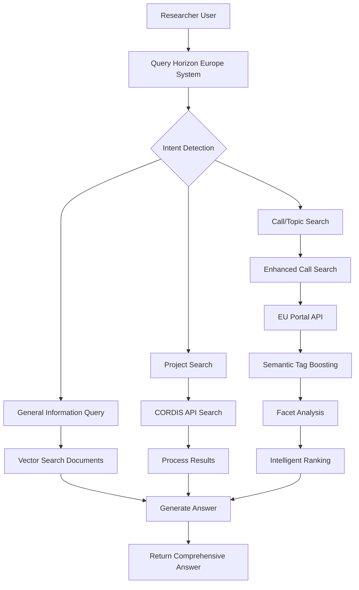
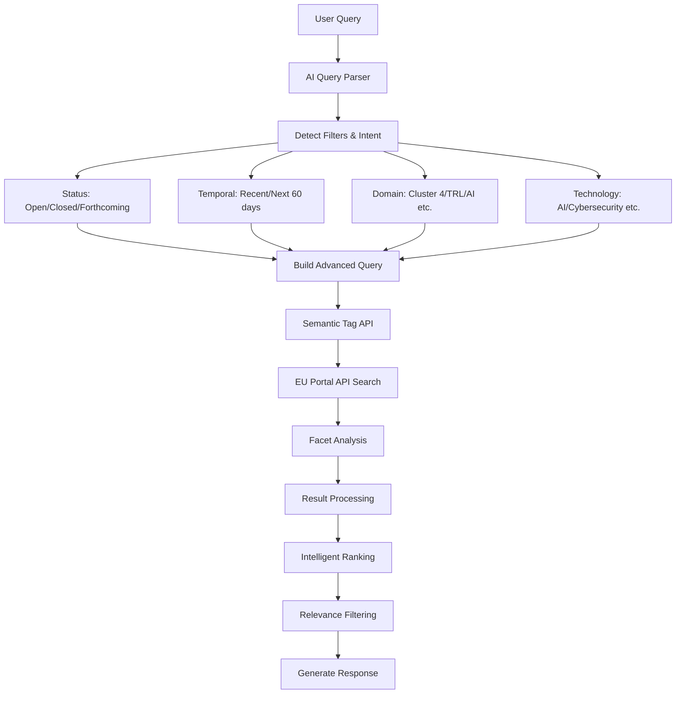
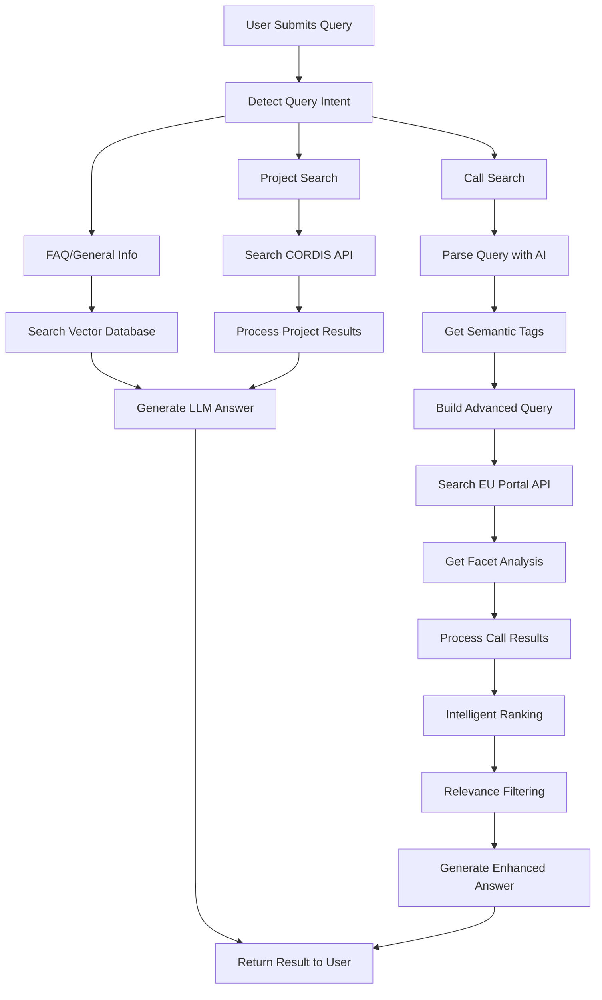

# Horizon Europe Call Discovery System - Use Cases & BPMN

## System Overview

The Horizon Europe Call Discovery System provides intelligent search anWd retrieval capabilities for European research funding opportunities through a multi-layered RAG architecture.

## Use Case Diagrams

### Primary Use Cases

### Detailed Use Case: Call/Topic Search

## BPMN Process Flows

### Main Query Processing Flow

### Enhanced Call Search Process

```mermaid
flowchart LR
    Start[Call Search Request] --> Parse[Parse Query with AI Parser]
    
    Parse --> StatusFilter{Status Filter Detected?}
    StatusFilter -->|Yes| ApplyStatus[Apply Status Filter]
    StatusFilter -->|No| CheckTemporal{Time Filter?}
    
    ApplyStatus --> CheckTemporal
    
    CheckTemporal -->|Yes| ApplyTime[Apply Time Filter]
    CheckTemporal -->|No| CheckDomain{Domain Filter?}
    
    ApplyTime --> CheckDomain
    
    CheckDomain -->|Yes| ApplyDomain[Apply Domain Filter]
    CheckDomain -->|No| GetSemanticTags[Get Semantic Tags]
    
    ApplyDomain --> GetSemanticTags
    
    GetSemanticTags --> BuildQuery[Build Advanced Query]
    BuildQuery --> ExecuteSearch[Execute EU Portal Search]
    ExecuteSearch --> GetFacets[Get Facet Analysis]
    GetFacets --> Process[Process & Enrich Results]
    Process --> Rank[Intelligent Ranking]
    Rank --> Filter[Relevance Filtering]
    Filter --> Generate[Generate Response]
    Generate --> Return[Return Enhanced Results]
```

## Actor Roles

### Primary Actors
1. **Researchers** - Primary users searching for funding opportunities
2. **Grant Managers** - Professionals managing research proposals
3. **Research Administrators** - Institutional support staff

### Secondary Actors
1. **EU Funding & Tenders Portal** - External API service
2. **Client-Centricity.io** - Semantic tag service
3. **CORDIS Database** - Project information service
4. **Vector Database** - Local document storage

## Key Process Steps

### 1. Query Intent Detection
- **Input**: Natural language query
- **Processing**: AI-powered intent classification
- **Output**: Intent type (FAQ, PROJECTS, CALLS) + confidence

### 2. Query Parsing & Filtering
- **Status Filters**: Open, Closed, Forthcoming calls
- **Temporal Filters**: Recent, Next 60 days, Current year
- **Domain Filters**: Cluster 4, TRL levels, specific technologies
- **Technology Filters**: AI, Cybersecurity, Edge Computing, etc.

### 3. Enhanced Search Execution
- **Semantic Tag Boosting**: Client-centricity.io API integration
- **Advanced Query Construction**: Boolean logic with field-specific boosts
- **Facet Analysis**: Programme division, status distribution
- **Intelligent Ranking**: Multi-factor relevance scoring

### 4. Result Processing
- **Result Enrichment**: Enhanced descriptions, URL construction
- **Relevance Filtering**: Term overlap, phrase matching, domain relevance
- **Response Generation**: Structured answers with explanations

## Exception Handling

### API Failures
- **EU Portal API**: Fallback to basic search parameters
- **Semantic Tag API**: Continue without tag boosting
- **CORDIS API**: Return error message with guidance

### No Results
- **Filter Explanations**: Explain why no results found
- **Alternative Suggestions**: Suggest broader search terms
- **Portal Redirect**: Provide direct EU portal links

### Parse Errors
- **AI Parser Failure**: Fallback to rule-based parsing
- **Query Understanding**: Default to broad search

## Performance Metrics

### Success Indicators
- **Query Understanding Accuracy**: >90% intent detection
- **API Response Time**: <5 seconds for most queries
- **Result Relevance**: >80% relevant results
- **User Satisfaction**: Reduced need for manual portal searching

### Monitoring Points
- **API Latency**: EU Portal, Semantic Tag services
- **Cache Hit Rates**: Query, tag, and result caching
- **Error Rates**: API failures, parse errors
- **User Engagement**: Query types, result usage patterns

## Integration Points

### External Services
1. **EU Funding & Tenders Portal API**
   - Search endpoint: `/search`
   - Facet endpoint: `/facet`
   - Rate limiting: Unknown, conservative usage recommended

2. **Client-Centricity.io Semantic Tags**
   - Tags endpoint: `/tags/query`
   - Cache TTL: 1 hour recommended

3. **CORDIS API**
   - Project search and metadata
   - Historical project information

### Internal Services
1. **Vector Database**
   - Document chunk storage and retrieval
   - Semantic search capabilities

2. **LLM Services**
   - OpenAI GPT-4 Turbo or Gemini 2.5 Flash
   - Prompt engineering for Horizon Europe domain

## Security Considerations

### Data Privacy
- **User Queries**: Not stored long-term
- **API Keys**: Environment variable management
- **Cache Contents**: Ephemeral, no PII storage

### Rate Limiting
- **External APIs**: Conservative usage patterns
- **Retry Logic**: Exponential backoff for failures
- **Circuit Breakers**: Prevent cascade failures

## Future Enhancements

### Planned Features
1. **User Profiles**: Personalized search preferences
2. **Alert System**: Call deadline notifications
3. **Collaboration Tools**: Team sharing of opportunities
4. **Analytics Dashboard**: Search trends and success metrics

### Technical Improvements
1. **Cache Optimization**: More aggressive caching strategies
2. **Query Optimization**: Better query understanding and expansion
3. **API Enhancements**: Additional EU portal endpoints
4. **Mobile Support**: Responsive design and mobile apps