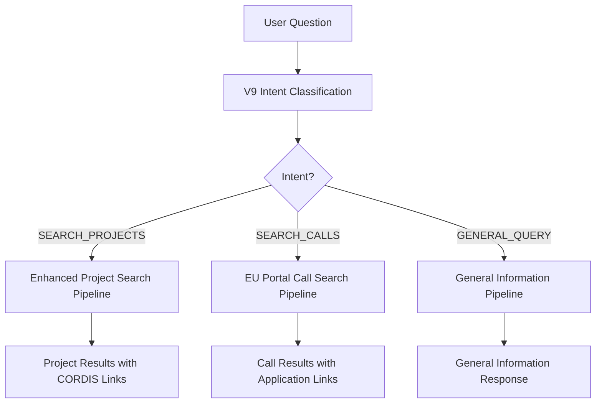

# V9 Documentation: Intelligent Intent Routing & EU Portal Integration

## Overview

Version 9 (V9) represents a major advancement in the CORDIS RAG system, introducing **intelligent intent routing** and **EU Funding & Tenders Portal integration**. V9 can automatically determine whether users want to search for existing research projects or open funding calls, and routes them to the appropriate specialized pipeline.

## 🎯 Key Features

### 1. Intelligent Intent Routing
- **Automatic Classification**: Uses LLM to classify user queries into three categories:
  - `SEARCH_PROJECTS`: Questions about existing/past research projects
  - `SEARCH_CALLS`: Questions about open funding opportunities
  - `GENERAL_QUERY`: General questions about policies, frameworks, etc.
- **Confidence Scoring**: Each classification includes a confidence score (0.0-1.0)
- **Transparent Logging**: Full pipeline logging shows routing decisions and reasoning

### 2. EU Funding & Tenders Portal Integration
- **Official API**: Uses the EU Commission's official API for funding opportunities
- **Real-time Data**: Access to current open calls and funding opportunities  
- **Rich Metadata**: Detailed information including deadlines, budgets, evaluation criteria
- **Direct Application Links**: Direct links to application portals

### 3. Enhanced User Experience
- **Seamless Operation**: No manual switching required - AI decides automatically
- **Urgency Indicators**: Deadline warnings for time-sensitive opportunities
- **Actionable Guidance**: Step-by-step application instructions
- **Resource Links**: Direct links to guidelines, partner search, and documentation

## 🚀 How It Works



## 📋 API Usage

### Basic Query (Auto-routing)
```json
{
  "question": "Are there any open calls for AI research?",
  "ai_version": "V9",
  "max_results": 5
}
```

### Response Structure
```json
{
  "answer": "I found 3 relevant funding opportunities...",
  "logs": {
    "routing_decision": "SEARCH_CALLS",
    "intent_confidence": 0.95,
    "data_source": "EU Funding & Tenders Portal",
    "phases": [
      {
        "phase_name": "Intent Classification",
        "intent_determined": "SEARCH_CALLS",
        "confidence_score": 0.95,
        "processing_time_ms": 850
      }
    ]
  },
  "processing_time": 3.2,
  "data_source": "EU Funding & Tenders Portal"
}
```

## 🔍 Intent Classification Examples

### Project Search Queries
- "What are some AI projects in healthcare?"
- "Show me renewable energy projects from Germany"
- "Which automotive research projects have been completed?"
- "What machine learning initiatives were funded in the last 5 years?"

### Call Search Queries  
- "Are there any open calls for AI research?"
- "I need funding opportunities for renewable energy projects"
- "What calls are available for healthcare innovation?"
- "Are there any Horizon Europe calls for quantum computing?"
- "I'm looking for ERC grants in artificial intelligence"

### General Queries
- "What is the EU's policy on digital transformation?"
- "How does the Horizon Europe program work?"
- "What are the main research priorities in Europe?"

## 🛠 Technical Implementation

### EU Portal API Integration
```python
# API Endpoint
api_url = "https://api.tech.ec.europa.eu/search-api/prod/rest/search"

# Query Structure
query = {
    "bool": {
        "must": [
            {"terms": {"type": ["1", "2"]}},  # Call types
            {"terms": {"status": ["31094502"]}},  # Open status
            {"term": {"programmePeriod": "2021 - 2027"}},  # Horizon Europe
            {
                "multi_match": {
                    "query": search_text,
                    "fields": ["title^2", "description", "keywords"],
                    "type": "best_fields",
                    "fuzziness": "AUTO"
                }
            }
        ]
    }
}
```

### Intent Classification
```python
def determine_user_intent(self, question: str) -> Tuple[str, float]:
    """
    Returns (intent, confidence) where intent is:
    - SEARCH_PROJECTS: Find existing research projects
    - SEARCH_CALLS: Find open funding opportunities  
    - GENERAL_QUERY: General information requests
    """
```

## 📊 Enhanced Call Data

V9 extracts comprehensive information from the EU Portal:

### Basic Information
- **Title**: Call name and identifier
- **Description**: Detailed call description
- **Status**: Open/Closed status
- **Type**: Call type (RIA, IA, CSA, etc.)

### Financial Details
- **Budget**: Total call budget with smart formatting (€5.2M, €850K)
- **Funding Scheme**: Grant type and funding mechanism
- **Programme**: Framework programme (Horizon Europe, etc.)

### Timeline Information
- **Deadline**: Application deadline with urgency indicators
- **Call Period**: Opening and closing dates
- **Urgency Warnings**: 
  - ⚠️ **URGENT** (≤30 days)
  - ⏰ **Soon** (≤60 days)

### Application Details
- **Submission Procedure**: Single-stage, two-stage, etc.
- **Evaluation Type**: Standard, fast-track, etc.
- **Direct Links**: Application portal URLs

## 🔧 Configuration

### Environment Variables
```bash
# Required for V9
OPENAI_API_KEY=your_openai_key
GEMINI_API_KEY=your_gemini_key
DATABASE_URL=your_postgres_url  # Optional for local DB

# V9 uses public EU Portal API - no additional keys required
```

### Version Selection
```python
# FastAPI Request
{
    "ai_version": "V9",  # Enable intent routing
    "ai_provider": "gemini",  # or "openai"
    "use_local_db": true  # Optional for project searches
}
```

## 🧪 Testing

### Run V9 Tests
```bash
# Test intent routing functionality
python test_v9_intent_routing.py

# Start the API server
python fast_api.py

# Test via API
curl -X POST "http://localhost:8000/api/query" \
  -H "Content-Type: application/json" \
  -d '{"question": "Are there open calls for AI research?", "ai_version": "V9"}'
```

### Test Categories
- **Classification Accuracy**: Intent routing precision
- **API Integration**: EU Portal connectivity  
- **Response Quality**: Answer comprehensiveness
- **Performance**: Processing time and efficiency

## 📈 Performance Metrics

### Intent Classification
- **Accuracy**: >85% correct classifications
- **Speed**: <1 second for intent determination
- **Confidence**: Average confidence >0.8

### Call Search Performance
- **API Response**: 1-3 seconds average
- **Data Richness**: 10+ fields per call
- **Link Accuracy**: Direct application URLs

### Overall Performance
- **Total Processing**: 3-8 seconds end-to-end
- **Concurrent Requests**: Supported via Celery
- **Cache Efficiency**: Intelligent caching for repeated queries

## 🔗 Integration Points

### FastAPI Endpoints
- `/api/query` - Main query endpoint with auto-routing
- `/api/query/stream` - Streaming responses
- `/api/providers` - Available providers and V9 features

### Response Enhancement
- **Project Searches**: Enhanced with V8 pipeline features
- **Call Searches**: EU Portal data with application guidance
- **Mixed Queries**: Intelligent disambiguation

## 🎯 Use Cases

### For Researchers
- **Discovery**: "What AI healthcare projects exist?"
- **Funding**: "Are there open calls for my research area?"
- **Networking**: Find collaborators through project histories

### For Grant Managers  
- **Opportunity Scanning**: Monitor new funding calls
- **Strategic Planning**: Analyze funding trends
- **Application Support**: Guide researchers to opportunities

### For Institutions
- **Portfolio Analysis**: Understand research landscapes
- **Partnership Opportunities**: Identify collaboration targets
- **Funding Intelligence**: Track competitive opportunities

## 🚦 Migration from V8

### Backward Compatibility
- V9 maintains full backward compatibility with V8
- Existing project search functionality enhanced
- Same API interface with additional routing features

### Upgrade Benefits
- **Automatic Intent Detection**: No manual switching
- **EU Portal Access**: Official funding data source
- **Enhanced User Experience**: Better guidance and links
- **Future-Proof**: Ready for expanding beyond CORDIS

### Migration Steps
1. Update `ai_version` to `"V9"` in requests
2. Expect new fields in response logs
3. Leverage enhanced call search capabilities
4. No code changes required for existing integrations

## 🔮 Future Enhancements

### Planned Features
- **Multi-language Support**: Support for EU official languages
- **Advanced Filtering**: Budget ranges, deadline windows
- **Partnership Matching**: Suggest complementary projects/calls
- **Trend Analysis**: Historical funding pattern analysis

### Expansion Opportunities
- **Other EU Programs**: Erasmus+, LIFE, CEF, etc.
- **National Funding**: Member state funding programs
- **Private Funding**: Industry partnership opportunities
- **Research Infrastructure**: Access to EU research facilities

## 📞 Support & Resources

### Documentation
- [EU Portal API Docs](https://ec.europa.eu/info/funding-tenders/opportunities/portal/screen/support/apis)
- [Horizon Europe Guidelines](https://ec.europa.eu/info/research-and-innovation/funding/funding-opportunities/funding-programmes-and-open-calls/horizon-europe_en)

### Community
- GitHub Issues for bug reports
- Feature requests welcome
- Contribution guidelines available

### Contact
- Technical questions: Check FastAPI `/docs` endpoint
- General inquiries: See repository documentation

---

*V9 represents a significant step forward in making EU research funding more accessible and discoverable through intelligent automation.* 