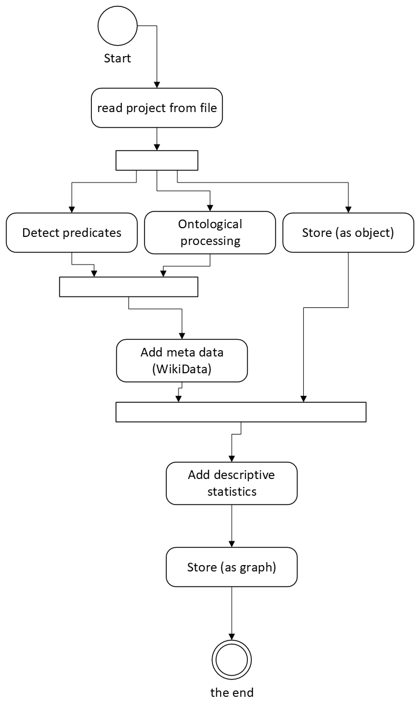

# architecture

# MAP-IT Horizon Project Software Architecture Document
Version: 1.0
Date: October 2, 2024

**Author: Marco Dumont**

1. Introduction
This document describes the software architecture for the MAP-IT Horizon project. The purpose of this document is to establish a common understanding of the structure, components, and interactions of the software system.

2. Goals
The software architecture must meet the following goals:

- Scalability: The system must be able to handle large amounts of data and grow with the needs of the project.
- Reliability: The system must be reliable and have minimal downtime.
- Maintainability: The system must be easy to maintain and update.
- Security: The system must protect user data and privacy.
- Integration: The system must be able to integrate with other systems and datasets.

3. Architecture Overview

4. Components
The main components of the system are:
   - Graph (containing knowledge).
   - RAGLLM
   - Promptbuilder
   - Dataloader (ETL stack) [data-analytics](./data-analytics.md)
   - Verifier

   1.  Data Ingestion
The main datascource is the CORDIS database, additional databases OPENAIR, WikiData) will be used to enhance the projects in the CORDIS database. 

The [ontology](Question_Ontology.pdf) based on sample questions is the basis for the graph.

The document [data-analytics](./data-analytics.md) shows the ingestion of the data. 
   2. Data Storage
   Data will be stored as a graph in [Dgraph](https://dgraph.io/)
   3. LLM
   [Mistral-largest (for now)](https://docs.mistral.ai/getting-started/models/models_overview/)
   4. User Interface
   
	
5. Technology Stack
Programming Language: Python
Database: Dgraph (open-source, free, native )
Web framework: (To be determined)
Other libraries: requests, pandas, dgraph, data analysis libraries
6. Deployment
Docker see [deployment](deployment.md) 

Notes (in dutch)
Graph: ~~Neo4j?~~ Dgraph (relations (edges) can be attributed with information )
- [[embedding]](https://github.com/dgraph-io/pydgraph/blob/master/examples/notebook/RAG/RAG_with_Dgraph.ipynb)
- [[Cordis OWL Graph to Python]](https://op.europa.eu/en/web/eu-vocabularies/dataset/-/resource?uri=http://publications.europa.eu/resource/dataset/eurio) using [[owlready2]](https://pypi.org/project/owlready2/) package.

CORDIS detils project info in XML-> https://lxml.de/objectify.html to dump the whole thing in Dgraph?

Installeren:

De standaard release voor d.graph is de standalone image(docker pull dgraph/standalone:latest).
Voor een GUI via browser kan gebruik worden gemaakt van de officiele ratel image (docker pull  dgraph/ratel:latest).
Het echte werk van D.graph wordt gedaan via de standalone. Dus als je de GUI gebruikt moet je die bovenop standalone draaien en in de GUI verbinding maken met de IP waar je de standalone container draait.
Om met Python te verbinden, is de pydgraph package gekomen https://github.com/dgraph-io/pydgraph

 

Data inladen

D.graph stelt zelf dat ze Json of RDF (recourse description framework) ondersteunen.
In de console kun je met mutate aanpassingen maken aan de database
Via Query kun je informatie terug halen.
Je laadt data in met de Live Loader https://dgraph.io/docs/howto/importdata/live-loader/

 

Als voorbeeld wou ik de Wikidata query service https://query.wikidata.org/ gebruiken maar ik kreeg geen output in json die ingelezen kon worden. Dus gebruiken we dgraph’s eigen tutorial dataset
https://github.com/dgraph-io/tutorial/tree/master/resources
Het is mij ook niet gelukt deze te laten laden.

 

Connect met LLM

Tutorial voor het gebruiken van D.graph met een random LLM (GPT3) https://dgraph.io/blog/post/20240724_rag_on_graph/
Onder de motorkap gebruikt het Huggingface SentenceTransformer… dus praktisch elke LLM gebruikt worden.

