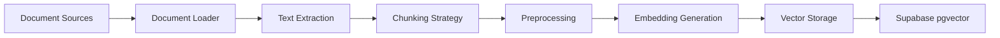
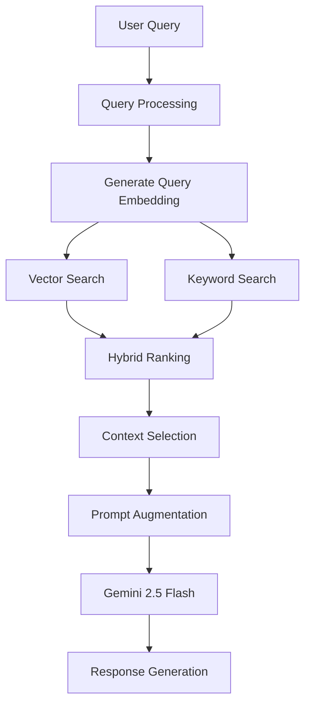

# Horizon Europe RAG System Architecture with Supabase pgvector

## System Overview

This document outlines the architecture for implementing a comprehensive RAG (Retrieval-Augmented Generation) system for Horizon Europe using Supabase pgvector as the vector database, integrated with your existing CORDIS project search capabilities.

## Architecture Components

### 1. Data Sources
- **Horizon Europe Documents**
  - Work Programme PDFs
  - Programme Guide
  - EU Funding & Tenders Portal Online Manual
  - EU Grants AGA (Annotated Grant Agreement)
  - Call documentation
  - Previously funded projects from CORDIS

- **Web Content**
  - European Commission website pages
  - EU Funding & Tenders Portal
  - CORDIS database entries
  - FAQ pages

### 2. Document Processing Pipeline



### 3. Vector Database Schema (Supabase)

```sql
-- Main documents table
CREATE TABLE horizon_documents (
    id UUID PRIMARY KEY DEFAULT gen_random_uuid(),
    source_type TEXT NOT NULL, -- 'pdf', 'web', 'cordis'
    source_url TEXT,
    title TEXT NOT NULL,
    document_type TEXT, -- 'work_programme', 'guide', 'call', 'faq'
    programme_year TEXT,
    last_updated TIMESTAMP WITH TIME ZONE DEFAULT NOW(),
    metadata JSONB,
    created_at TIMESTAMP WITH TIME ZONE DEFAULT NOW()
);

-- Document chunks with embeddings
CREATE TABLE document_chunks (
    id UUID PRIMARY KEY DEFAULT gen_random_uuid(),
    document_id UUID REFERENCES horizon_documents(id) ON DELETE CASCADE,
    chunk_index INTEGER NOT NULL,
    content TEXT NOT NULL,
    embedding vector(768), -- Google's text-embedding-004 dimension
    metadata JSONB,
    token_count INTEGER,
    created_at TIMESTAMP WITH TIME ZONE DEFAULT NOW()
);

-- Create indexes for performance
CREATE INDEX idx_document_chunks_embedding ON document_chunks 
USING ivfflat (embedding vector_cosine_ops)
WITH (lists = 100);

CREATE INDEX idx_document_chunks_document_id ON document_chunks(document_id);
CREATE INDEX idx_documents_source_type ON horizon_documents(source_type);
CREATE INDEX idx_documents_document_type ON horizon_documents(document_type);
```

### 4. Embedding Strategy

- **Model**: Google's text-embedding-004 (768 dimensions)
- **Chunking Strategy**:
  - Chunk size: 1000 tokens with 200 token overlap
  - Smart chunking: Respect paragraph and section boundaries
  - Metadata preservation: Keep section headers and context

### 5. Retrieval Pipeline



### 6. Integration Points

#### With Existing CORDIS System
- Unified query interface
- Combined results from CORDIS projects and Horizon Europe documents
- Cross-referencing between projects and programme documentation

#### API Endpoints
```
POST /api/documents/ingest     - Upload and process documents
GET  /api/documents/search     - Search documents
POST /api/rag/query           - RAG query with document context
GET  /api/documents/status     - Check ingestion status
POST /api/embeddings/generate  - Generate embeddings for text
```

## Implementation Phases

### Phase 1: Infrastructure Setup
1. Configure Supabase project with pgvector
2. Create database schema
3. Set up authentication and RLS policies

### Phase 2: Document Ingestion
1. Build PDF extraction pipeline
2. Implement web scraping for EU portals
3. Create chunking and preprocessing logic
4. Set up embedding generation with Google API

### Phase 3: Vector Search Implementation
1. Implement semantic search functionality
2. Build hybrid search combining vector and keyword search
3. Create relevance ranking algorithms
4. Add metadata filtering capabilities

### Phase 4: RAG Integration
1. Integrate vector search with existing query pipeline
2. Implement context selection and ranking
3. Build prompt augmentation strategies
4. Optimize response generation

### Phase 5: Production Features
1. Add caching layer for embeddings
2. Implement incremental updates
3. Set up monitoring and analytics
4. Create admin interface for document management

## Key Design Decisions

### Why Supabase pgvector?
- **Unified Stack**: Already using PostgreSQL, keeps everything in one place
- **Built-in Features**: Authentication, RLS, real-time subscriptions
- **Performance**: HNSW indexing provides excellent search performance
- **Cost-Effective**: Scales well for millions of vectors
- **SQL Power**: Combine vector search with structured queries

### Chunking Strategy
- **Semantic Coherence**: Chunks maintain context and meaning
- **Overlap**: 200 token overlap ensures continuity
- **Metadata**: Each chunk carries source and section information

### Hybrid Search Approach
- **Vector Search**: For semantic similarity
- **Keyword Search**: For specific terms and acronyms
- **BM25 Ranking**: Combined scoring for best results

## Performance Optimizations

1. **Indexing**:
   - IVFFlat index for initial implementation
   - HNSW index for production (better recall)
   
2. **Caching**:
   - Redis cache for frequent queries
   - Embedding cache for common documents
   
3. **Batch Processing**:
   - Bulk embedding generation
   - Parallel document processing

## Monitoring & Analytics

- Query performance metrics
- Search relevance scoring
- User feedback integration
- Document coverage analysis
- System health monitoring

## Security Considerations

- Row Level Security (RLS) for document access
- API rate limiting
- Secure embedding storage
- Audit logging for document access

## Next Steps

1. Set up Supabase project and enable pgvector
2. Create initial database schema
3. Build document ingestion pipeline
4. Implement basic vector search
5. Integrate with existing RAG system