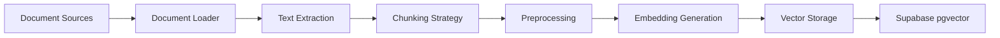
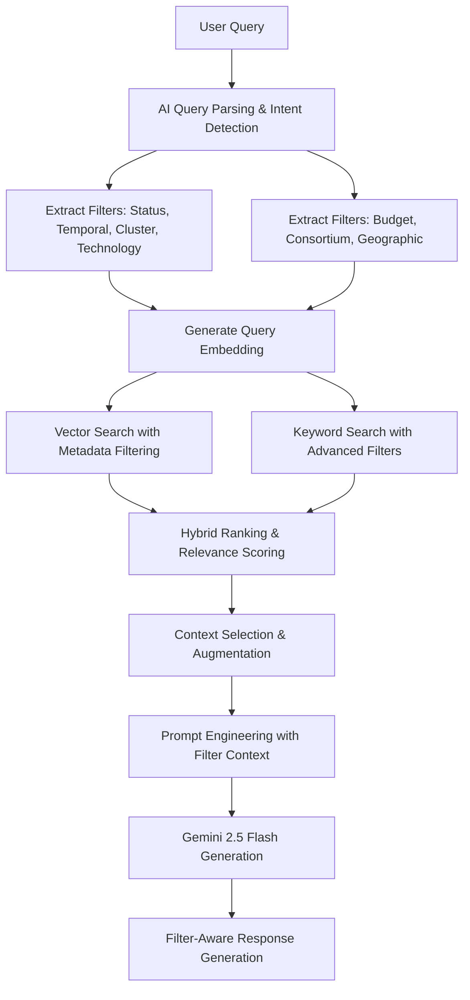

# Horizon Europe RAG System Architecture with Supabase pgvector

## System Overview

This document outlines the architecture for implementing a comprehensive RAG (Retrieval-Augmented Generation) system for Horizon Europe using Supabase pgvector as the vector database, integrated with your existing CORDIS project search capabilities.

## Architecture Components

### 1. Data Sources
- **Horizon Europe Documents**
  - Work Programme PDFs
  - Programme Guide
  - EU Funding & Tenders Portal Online Manual
  - EU Grants AGA (Annotated Grant Agreement)
  - Call documentation
  - Previously funded projects from CORDIS

- **Web Content**
  - European Commission website pages
  - EU Funding & Tenders Portal
  - CORDIS database entries
  - FAQ pages

### 2. Document Processing Pipeline



### 3. Vector Database Schema (Supabase)

```sql
-- Main documents table
CREATE TABLE horizon_documents (
    id UUID PRIMARY KEY DEFAULT gen_random_uuid(),
    source_type TEXT NOT NULL, -- 'pdf', 'web', 'cordis'
    source_url TEXT,
    title TEXT NOT NULL,
    document_type TEXT, -- 'work_programme', 'guide', 'call', 'faq'
    programme_year TEXT,
    last_updated TIMESTAMP WITH TIME ZONE DEFAULT NOW(),
    metadata JSONB,
    created_at TIMESTAMP WITH TIME ZONE DEFAULT NOW()
);

-- Document chunks with embeddings
CREATE TABLE document_chunks (
    id UUID PRIMARY KEY DEFAULT gen_random_uuid(),
    document_id UUID REFERENCES horizon_documents(id) ON DELETE CASCADE,
    chunk_index INTEGER NOT NULL,
    content TEXT NOT NULL,
    embedding vector(768), -- Google's text-embedding-004 dimension
    metadata JSONB,
    token_count INTEGER,
    created_at TIMESTAMP WITH TIME ZONE DEFAULT NOW()
);

-- Create indexes for performance
CREATE INDEX idx_document_chunks_embedding ON document_chunks 
USING ivfflat (embedding vector_cosine_ops)
WITH (lists = 100);

CREATE INDEX idx_document_chunks_document_id ON document_chunks(document_id);
CREATE INDEX idx_documents_source_type ON horizon_documents(source_type);
CREATE INDEX idx_documents_document_type ON horizon_documents(document_type);
```

### 4. Embedding Strategy

- **Model**: Google's text-embedding-004 (768 dimensions)
- **Chunking Strategy**:
  - Chunk size: 1000 tokens with 200 token overlap
  - Smart chunking: Respect paragraph and section boundaries
  - Metadata preservation: Keep section headers and context

### 5. Enhanced Retrieval Pipeline with Advanced Filtering



**Key Enhancements:**
- **AI-Powered Intent Routing**: Determines query type (FAQ, SEARCH_PROJECTS, SEARCH_CALLS)
- **Comprehensive Filter Extraction**: Status, temporal, cluster-specific, technology-focused
- **Advanced Metadata Filtering**: Budget ranges, consortium size, geographic scope
- **Unified Service Architecture**: Single EnhancedRAGService handles all query types
- **Cluster-Specific Processing**: Specialized handling for all 6 Horizon Europe clusters

### 6. Integration Points

#### With Existing CORDIS System
- Unified query interface with intelligent intent routing
- Combined results from CORDIS projects and Horizon Europe documents
- Cross-referencing between projects and programme documentation
- Consolidated service architecture eliminates circular dependencies

#### Enhanced API Endpoints
```
POST /api/documents/ingest        - Upload and process documents
GET  /api/documents/search        - Search documents with advanced filtering
POST /api/rag/query              - RAG query with document context and intent detection
GET  /api/documents/status        - Check ingestion status
POST /api/embeddings/generate     - Generate embeddings for text
POST /api/query/parse            - AI-powered query parsing and intent detection
GET  /api/clusters/{id}/info      - Get cluster-specific information
```

#### Key Integration Benefits:
- **Reduced Complexity**: Single EnhancedRAGService代替 multiple redundant services
- **Improved Performance**: Eliminated circular dependencies and duplicate processing
- **Enhanced Capabilities**: Full cluster coverage and advanced filtering support
- **Better Maintainability**: Simplified codebase with consolidated functionality

## Implementation Phases

### Phase 1: Infrastructure Setup
1. Configure Supabase project with pgvector
2. Create database schema
3. Set up authentication and RLS policies

### Phase 2: Document Ingestion
1. Build PDF extraction pipeline
2. Implement web scraping for EU portals
3. Create chunking and preprocessing logic
4. Set up embedding generation with Google API

### Phase 3: Vector Search Implementation
1. Implement semantic search functionality
2. Build hybrid search combining vector and keyword search
3. Create relevance ranking algorithms
4. Add metadata filtering capabilities

### Phase 4: RAG Integration
1. Integrate vector search with existing query pipeline
2. Implement context selection and ranking
3. Build prompt augmentation strategies
4. Optimize response generation

### Phase 5: Production Features
1. Add caching layer for embeddings
2. Implement incremental updates
3. Set up monitoring and analytics
4. Create admin interface for document management

## Key Design Decisions

### Why Supabase pgvector?
- **Unified Stack**: Already using PostgreSQL, keeps everything in one place
- **Built-in Features**: Authentication, RLS, real-time subscriptions
- **Performance**: HNSW indexing provides excellent search performance
- **Cost-Effective**: Scales well for millions of vectors
- **SQL Power**: Combine vector search with structured queries

### Chunking Strategy
- **Semantic Coherence**: Chunks maintain context and meaning
- **Overlap**: 200 token overlap ensures continuity
- **Metadata**: Each chunk carries source and section information

### Hybrid Search Approach
- **Vector Search**: For semantic similarity
- **Keyword Search**: For specific terms and acronyms
- **BM25 Ranking**: Combined scoring for best results

## Performance Optimizations

### 1. Indexing Strategies
- **IVFFlat Index**: Initial implementation for balanced performance and recall
- **HNSW Index**: Production-ready for superior recall and speed (recommended for >100K vectors)
- **Composite Indexes**: Combine vector search with metadata filters for faster queries
- **Index Tuning**: Regular index maintenance and vacuuming for optimal performance

### 2. Caching Mechanisms
- **Query Result Caching**: Redis cache for frequent queries with 1-hour TTL
- **Embedding Cache**: Store frequently used embeddings to reduce API calls
- **Intent Detection Cache**: Cache AI intent classification results for similar queries
- **Metadata Cache**: Cache cluster and technology mappings for faster filtering

### 3. Batch Processing & Parallelism
- **Bulk Embedding Generation**: Process documents in batches of 100-1000 to optimize API usage
- **Parallel Document Processing**: Use ThreadPoolExecutor for concurrent text extraction and chunking
- **Async API Calls**: Non-blocking API requests for embedding generation and AI processing
- **Database Batch Inserts**: Bulk insert operations for document chunks to reduce database round-trips

### 4. Query Optimization Techniques
- **Early Filtering**: Apply metadata filters before vector search to reduce search space
- **Query Batching**: Process multiple related queries in single API calls when possible
- **Result Limiting**: Use LIMIT clauses and pagination to avoid unnecessary data transfer
- **Connection Pooling**: Database connection pooling for better concurrent performance

### 5. Memory Management
- **Streaming Processing**: Process large documents in streams to avoid memory overload
- **Garbage Collection**: Regular cleanup of temporary objects and caches
- **Resource Monitoring**: Monitor memory usage and implement throttling mechanisms

### 6. Network Optimization
- **CDN for Static Assets**: Use CDN for frequently accessed document resources
- **API Rate Limiting**: Implement smart rate limiting to avoid API throttling
- **Geographic Optimization**: Deploy services closer to data sources for reduced latency

### 7. Database Performance
- **Query Analysis**: Regular EXPLAIN ANALYZE on database queries
- **Index Optimization**: Monitor and adjust index parameters based on query patterns
- **Partitioning**: Consider table partitioning for very large datasets
- **Vacuum & Analyze**: Regular database maintenance for query planner accuracy

## Monitoring & Analytics

- Query performance metrics
- Search relevance scoring
- User feedback integration
- Document coverage analysis
- System health monitoring

## Security Considerations

- Row Level Security (RLS) for document access
- API rate limiting
- Secure embedding storage
- Audit logging for document access

## Architectural Improvements Summary

### Completed Enhancements:
1. **Service Consolidation**: Merged CallSpecificRAG into EnhancedRAGService, eliminating redundancy
2. **Redundant Code Removal**: Deleted intelligent_query_parser.py and obsolete test files
3. **Full Cluster Coverage**: Added support for all 6 Horizon Europe clusters with specialized processing
4. **Technology Expansion**: Added Robotics, IoT, blockchain, 5G/6G, biotech, nanotech filters
5. **Advanced Filtering**: Implemented budget ranges, consortium size, and geographic filters
6. **AI Query Parser Enhancement**: Comprehensive prompt with all filter categories and examples

### Next Steps

1. **Performance Optimization**: Implement caching for frequent queries and embeddings
2. **User Experience**: Enhance response formatting with filter-aware explanations
3. **Data Quality**: Improve document coverage for all clusters and technologies
4. **Monitoring**: Add analytics for filter usage and success rates
5. **Maintenance**: Regular updates to cluster definitions and technology mappings

## Data Quality Enhancements

### 1. Comprehensive Document Coverage
- **Cluster-Specific Documentation**: Ensure all 6 Horizon Europe clusters have complete and up-to-date documentation
- **Technology Focus Areas**: Expand coverage for Robotics, IoT, blockchain, 5G/6G, biotech, and nanotech topics
- **EU Source Integration**: Regular synchronization with EU Funding & Tenders Portal and CORDIS database
- **Gap Analysis**: Periodic audits to identify missing or outdated documentation

### 2. Content Quality Assurance
- **Automated Validation**: Implement checks for document completeness and accuracy
- **Manual Review Process**: Subject matter expert reviews for critical documentation
- **Version Control**: Track document versions and update frequencies
- **Broken Link Detection**: Regular scanning and fix broken references to EU sources

### 3. Metadata Enrichment
- **Enhanced Tagging**: Improve metadata tagging for better search and filtering
- **Cluster Attribution**: Ensure all documents are properly tagged with Horizon Europe clusters
- **Technology Keywords**: Expand keyword coverage for all supported technologies
- **Temporal Metadata**: Add publication and update timestamps for relevance ranking

### 4. User Feedback Integration
- **Feedback Loop**: Implement user rating system for search results quality
- **Response Accuracy Tracking**: Monitor and improve answer accuracy based on user interactions
- **Coverage Requests**: Allow users to request specific document or topic coverage
- **Quality Metrics**: Track and report on data quality indicators

### 5. Update Mechanisms
- **Automated Crawling**: Scheduled web scraping for EU portal updates
- **API Integration**: Real-time updates from official EU APIs when available
- **Change Detection**: Alert system for significant document changes
- **Incremental Updates**: Smart update system that only processes changed content

## User Experience Improvements

### 1. Enhanced Response Formatting
- **Structured Responses**: Clear sectioning with headings for different information types
- **Visual Indicators**: Icons and color coding for status, urgency, and relevance
- **Actionable Links**: Direct links to EU portals and application resources
- **Summary Sections**: Executive summaries for quick scanning of key information

### 2. Filter-Aware Explanations
- **Transparent Filtering**: Clearly explain which filters were applied and why
- **Confidence Indicators**: Show confidence levels for intent detection and results
- **Alternative Suggestions**: Offer related queries or broader/narrower searches
- **Filter Customization**: Allow users to adjust or remove filters easily

### 3. Interactive Query Refinement
- **Query Suggestions**: Real-time suggestions as users type their questions
- **Filter Presets**: Pre-defined filter combinations for common search patterns
- **Visual Filter Interface**: GUI for non-technical users to apply complex filters
- **Search History**: Save and recall previous searches with their results

### 4. Error Handling and Guidance
- **Helpful Error Messages**: Clear explanations and solutions for common issues
- **Contextual Help**: Tooltips and guidance based on user actions
- **Fallback Strategies**: Graceful degradation when specific features are unavailable
- **Progress Indicators**: Show processing status for long-running queries

### 5. Personalization Features
- **User Profiles**: Save preferences and frequently used filters
- **Notification System**: Alerts for new calls matching saved search criteria
- **Customized Ranking**: Personal relevance ranking based on user behavior
- **Language Preferences**: Support for multiple EU languages where available

## Maintenance and Code Cleanup Strategies

### 1. Regular Dependency Updates
- **Automated Security Updates**: Regular patches for security vulnerabilities
- **Version Compatibility**: Regular testing with latest library versions
- **Deprecation Monitoring**: Proactive replacement of deprecated features
- **Performance Benchmarking**: Regular performance testing after updates

### 2. Code Quality Assurance
- **Static Analysis**: Regular code quality checks with tools like pylint, mypy
- **Test Coverage**: Maintain high test coverage for critical components
- **Refactoring Cycles**: Scheduled code refactoring to reduce technical debt
- **Documentation Updates**: Keep code comments and docs synchronized with changes

### 3. Monitoring and Alerting
- **System Health Monitoring**: Real-time monitoring of all service components
- **Performance Metrics**: Track response times, error rates, and resource usage
- **Anomaly Detection**: Automated detection of unusual patterns or errors
- **Alert Escalation**: Multi-level alerting for different severity issues

### 4. Backup and Recovery
- **Regular Backups**: Automated backups of database and configuration
- **Disaster Recovery**: Documented procedures for system restoration
- **Data Integrity Checks**: Regular verification of database consistency
- **Rollback Procedures**: Safe rollback mechanisms for failed deployments

### 5. Knowledge Management
- **Runbook Documentation**: Detailed procedures for common maintenance tasks
- **Onboarding Materials**: Resources for new developers and maintainers
- **Issue Tracking**: Comprehensive system for tracking bugs and improvements
- **Lessons Learned**: Documenting and applying insights from past incidents

### 6. Community and Ecosystem
- **Open Source Contributions**: Share improvements with relevant open source projects
- **Standards Compliance**: Adherence to EU digital standards and best practices
- **Partnership Opportunities**: Collaborate with EU institutions for better integration
- **User Community Engagement**: Gather feedback and ideas from actual users